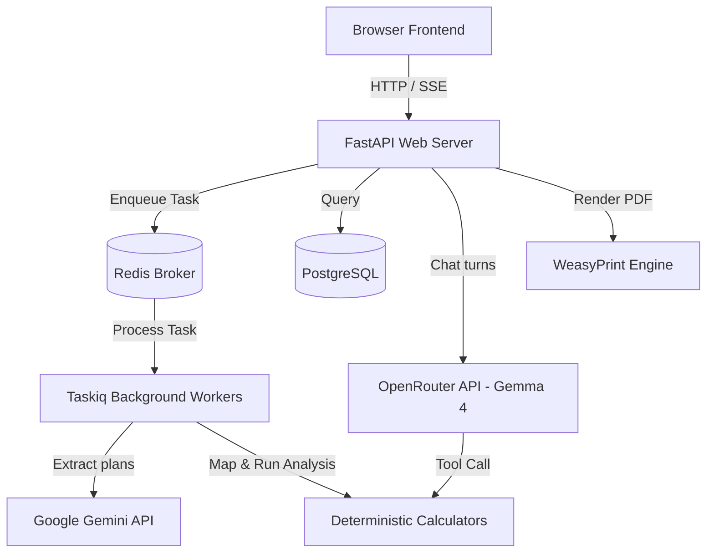

# SmartStructs Backend — Technical Overview & Architecture

This document provides a comprehensive technical overview and architecture description for the entire SmartStructs Backend project.

---

## 1. System Architecture Overview

SmartStructs is a hybrid conversational and automated plan-processing platform for structural engineering calculations (wood, masonry, and concrete). It bridges large language models (multimodal Gemma 4 & Gemini) with deterministic calculations libraries to run code-compliance checks.

The backend is built in **Python** using the **FastAPI** web framework and uses **PostgreSQL** as the primary data store (with SQLAlchemy + Alembic).

---

## 2. Key Components

### 2.1 FastAPI Web Router Layer
Defined under `app/routes/`, handling the main API controller endpoints:
- **`routes/auth`**: User registration, login, JWT issuance, OTP email verification (via Resend), and Google SSO.
- **`routes/agent`**: Orchestrates uploading PDF structural framing plans, initializing background tasks, and checking status.
- **`routes/analysis`**: Orchestrates structural calculations on extracted building plan schemas.
- **`routes/chatbot`**: Serves streaming chat completions via Server-Sent Events (SSE), handles calculation sheets and crud endpoints related to previous chats.
- **`routes/report`**: Generates and serves downloadable calculation package PDFs.
- **`routes/payment`**: Polar payment gateway integration for managing user token credits.
- **`routes/crud`**: Database models CRUD helpers.

### 2.2 Background Workers & Plan Extraction (`taskiq_task/`)
- Uses **Taskiq** with a **Redis** broker to handle resource-heavy PDF plan extraction.
- Uploads documents to Google, invokes native Gemini multimodal processing with structured prompt schemas (`app/core/llm/prompts/`), parses the resulting structural elements, and runs heuristics mappings (`app/services/mapping/mapping.py`).

### 2.3 Structural Calculators Library (`services/calculators/`)
A suite of deterministic, code-governed calculations engines built per ASD/TMS/ACI codes:
- `horizontal_calc.py`: Sawn lumber/EWP beams, joists, and headers check (NDS).
- `ijoist_calc.py`: Weyerhaeuser TJI product limits check.
- `stud_wall_calc.py`: Stud spacing, out-of-plane wind, and axial loads.
- `post_calc.py` & `post_footing_calc.py`: Wood post columns and isolated footing checks.
- `footing_calc.py`: Strip and continuous footing bearing, shear, and reinforcement checks.
- `shear_wall_calc.py`: Wood shear walls segmented drift and anchorage schedules.
- `masonry_calc.py`: CMU wall out-of-plane and shear wall in-plane strength checks (TMS 402).
- `lateral_calc.py`: ASCE 7-22 directional wind procedure and ELF seismic lateral loads generators.

### 2.4 Conversational Engineering Assistant (`services/chatbot/`)
- Accesses `google/gemma-4-31b-it` via OpenRouter.
- Drives an agentic loop allowing parallel tool calls across all calculators.
- Saves multi-turn session history in the database under `chat_histories` in a JSONB format.
- Serves calculation packages rendered dynamically via an in-memory TTL store.

### 2.5 Report Generation Engine (`services/report/`)
- Compiles project data, lateral wind/seismic zone matrices, and per-member derivations.
- Formats self-contained HTML using standard style variables and outputs professional multi-sheet PDFs using **WeasyPrint**.

### 2.6 External APIs Integration (`services/hazard/`)
- USGS and ASCE API wrappers fetching site hazard data (ultimate wind speed, snow loads, seismic design coefficients) based on GPS coordinates.

---

## 3. Database Schema

Managed via SQLAlchemy in `app/database/models.py`:
- **`users`**: Emails, hashed passwords, token counts, SSO keys, and verification OTPs.
- **`projects`**: Project geometries, design codes/methods, coordinate positions, extracted data, analysis results, and generation states.
- **`chat_histories`**: Ephemeral and active chat logs saved as a JSONB array of messages.
- **`refresh_tokens`**: Active refresh tokens mapped to user emails.
- **`processed_orders`**: Webhook-tracked payment logs.
- **`oauth_exchange_codes`**: Multi-auth code verifications.

---

## 4. Main Workflows

### 4.1 Plan Process & Analysis Pipeline
1. **Upload**: User posts a framing plan PDF `/api/start_agent`.
2. **Debit**: The system decrements 1 user token, fetches USGS/ASCE hazard parameters, writes the project entry to DB, and offloads extraction to Taskiq.
3. **Extraction**: Background worker pushes PDF to the Gemini SDK, extracts structured schemas, filters invalid values, and stores them in `extracted_data`.
4. **Calculations**: User requests `/api/analysis/get_final_analysis/{project_id}`, invoking `run_structural_analysis` which maps inputs directly to NDS/ACI/TMS calculators and outputs demands and capacity utilization ratios.
5. **Reporting**: User downloads a WeasyPrint-rendered calculation package PDF `/api/download-report`.

### 4.2 Interactive Copilot Chat
1. **Prompt**: User submits message (and optional plan image) to `/api/chat/stream`.
2. **Fetch**: Chat history is retrieved from `chat_histories`.
3. **Evaluate**: Gemma 4 evaluates inputs. If it requests calculator runs, it issues function calls.
4. **Parallel Tool Run**: The chatbot service fires sync/async calculations concurrently, posts results back to Gemma, streams delta tokens to the client via SSE, and loops until final answers are produced.
5. **Persistence**: The updated JSONB message array is committed back to the database.
6. **Calc-Sheet**: If calculations succeeded, a calc sheet ID is returned. The UI can display a link to `/api/chat/calc-sheet/{id}`, pulling dynamic HTML reports directly from the TTL cache.
